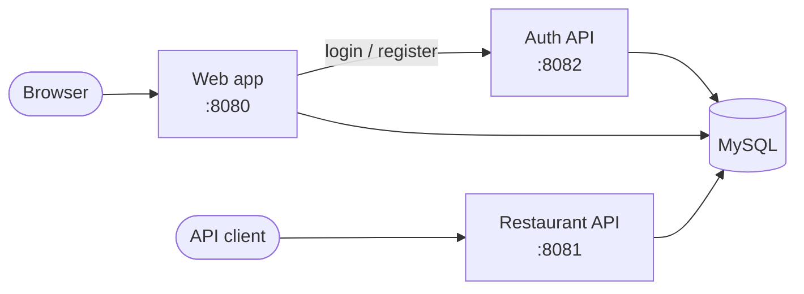
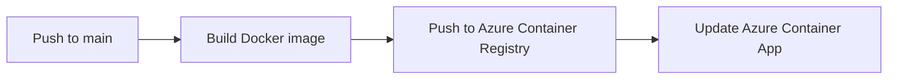

# The Lima Lounge — Restaurant Reservation System

A restaurant management and reservation system built with **Spring Boot 4** and **Java 21**. Staff can manage events, menus, dining tables and seatings, and customers can book a reservation and track its status.

The project is split into three services, packaged with **Docker**, run locally with **Docker Compose**, and was deployed to **Azure Container Apps** automatically by a **GitHub Actions** CI/CD pipeline.

## 🎥 Project walkthrough

▶️ **[Watch the video walkthrough](https://www.youtube.com/watch?v=2Md95Y7VZwY)**

The video demos the app and explains the architecture, Docker setup and CI/CD pipeline.

---

## Features

- **Events, menus and menu items** — create, edit, delete and search.
- **Dining tables and seatings** — set up tables and schedule time slots for each event.
- **Reservations** — customers book a seating and get a tracking link; staff approve or deny requests.
- **Accounts** — register and log in, secured with JWT tokens.
- **Email notifications** — sent through Spring Mail.

## Architecture



| Service | Module | What it does |
|---|---|---|
| Web app | `app-web` | Thymeleaf pages for staff and customers |
| Restaurant API | `app-restaurant-rest-api` | REST endpoints for events, menus and reservations |
| Auth API | `app-auth-rest-api` | Registration, login, and issuing and validating JWTs |

Each business area (`restaurant`, `auth`, `email`, `common`) is split into **domain → application → persistence → web/rest-api** layers. The three `app-*` modules are small Spring Boot launchers that pull in the layers they need, so the web app and the REST API share the same business logic.

## Tech stack

Java 21 · Spring Boot 4 (Web MVC, Data JPA, Security, OAuth2 Resource Server, Mail) · Thymeleaf · MySQL 8 · Maven multi-module · Swagger/OpenAPI · Docker · Docker Compose · GitHub Actions · Azure Container Apps

## Project structure

```
├── app-web/                  # Web app launcher
├── app-restaurant-rest-api/  # Restaurant API launcher
├── app-auth-rest-api/        # Auth API launcher
├── restaurant/               # Restaurant domain, services, persistence, web + REST controllers
├── auth/                     # Users, login and JWT token services
├── email/                    # Email service
├── common/                   # Shared validation, results, layout and error pages
├── Artifacts/                # UML diagrams for each sprint
├── Dockerfile
├── docker-compose.yaml
└── .github/workflows/deploy.yml
```

---

## Running the project

### Prerequisites
- [Docker Desktop](https://www.docker.com/products/docker-desktop/)
- A `.env` file in the project root. Copy [`.env.example`](.env.example) and fill in your own database credentials and RSA key pair. `.env` is gitignored and must never be committed.

### Start everything

```bash
docker compose up --build -d
```

| What | URL |
|---|---|
| Web app | http://localhost:8080 |
| Restaurant API docs | http://localhost:8081/swagger-ui.html |
| Auth API docs | http://localhost:8082/swagger-ui.html |
| Email inbox (Mailpit) | http://localhost:8025 |

To stop everything:

```bash
docker compose down
```

---

## 🐳 Docker

📄 [`Dockerfile`](Dockerfile) · 📚 [Docker docs](https://docs.docker.com/build/building/multi-stage/)

One **multi-stage Dockerfile** builds any of the three services. The `MODULE` build argument chooses which one.

1. **Build stage** — a Maven + JDK 21 image compiles only the chosen module and the modules it depends on.
2. **Runtime stage** — a small JRE-only image copies in just the final `.jar` and runs it.

The final image is small and contains no source code or build tools.

## 🧩 Docker Compose

📄 [`docker-compose.yaml`](docker-compose.yaml) · 📚 [Compose docs](https://docs.docker.com/compose/)

Compose starts the whole stack with one command:

- **MySQL** database, with a health check so the apps only start once it is ready
- **Mailpit** to catch outgoing emails during development
- The **three services**, each built from the same Dockerfile with a different `MODULE`

The services find each other by service name on Compose's private network, for example the web app calls `http://auth-api`.

## 🚀 CI/CD with GitHub Actions

📄 [`deploy.yml`](.github/workflows/deploy.yml) · ▶️ [Workflow runs](https://github.com/GurleenKaur655/LimaReservations/actions) · 📚 [GitHub Actions docs](https://docs.github.com/actions)

Every push to `main` triggers the pipeline. A **matrix** runs the same steps for all three services in parallel:



Each image is tagged with the commit SHA, so every deployment can be traced back to an exact commit. Registry and Azure credentials are stored as **GitHub encrypted secrets** and never appear in the code or logs.

## ☁️ Azure

📚 [Azure Container Apps docs](https://learn.microsoft.com/azure/container-apps/overview)

The project was hosted on Azure using:

- **Azure Container Registry** to store the Docker images
- **Azure Container Apps** to run each service, one container app per service
- **Azure Database for MySQL Flexible Server** as the production database

Database passwords and JWT keys were stored as **Container App secrets**, not as plain environment variables.

> The Azure deployment has been shut down to avoid costs. The video above shows it running.

---

## Security notes

- Tokens are **RSA-signed JWTs**. The Auth API signs them with a private key, and the other services verify them with the public key.
- Database credentials and JWT keys are not stored in the code. They come from `.env` locally, or from secrets in the cloud.

## Design artifacts

UML class diagrams for each sprint are in [`Artifacts/`](Artifacts): [Sprint 1](Artifacts/UML_Sprint1.md) · [Sprint 2](Artifacts/UML_Sprint2.md) · [Sprint 3](Artifacts/UML_Sprint3.md) · [Final](Artifacts/UML_Final.md)

---

## Credits

The application was built as a team project for the NBCC Restaurant Term Project by Team 12, "Lima".

The Docker setup, the Azure deployment and the GitHub Actions CI/CD pipeline were learned and implemented independently by **[Gurleen Kaur](https://github.com/GurleenKaur655)**.
